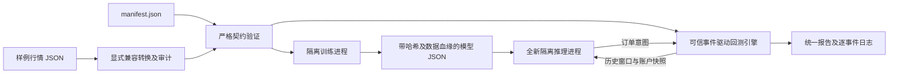

# SX-CH-003：技术路线与验收映射

## 规则基线

2026-10-15 核对官方 `.github` 仓库，固定 commit
`d3dbd28b0c3ca1d18a64412cbfeadc3500926d2a`。官方状态表的 SX-CH-003 S/A 均开放。
题面 SHA256：`4c9880b73d26e0a518bc9615e79db60824073571b56374bcc499e34336bed162`。

原文链接见 `docs/SOURCES.json`。参赛需完整代码、环境、样例数据、错误日志与报告；
三类策略各至少 6 个；失败不能降级伪装成功。S 档上限 9,500 元，最终认证及金额由主办方评审决定。
首次完整提交仅一次，送达后版本不能修改；首次 A 档可在确认邮件发出后 120 小时内提交一次 S 档升级，且 S 档须仍开放。
默认私密邮件 `join@singularityx.tech`，公开 PR 可选。每次邮件须附真实姓名、有效联系方式和本人 GitHub 完整主页。
五个工作日内答复不等于五个工作日内完成验收。
协议第八章涉及采纳/认证后的知识产权与商业使用权，提交前应结合实际结算条款确认；不在本工程中擅自授予开源许可。

## 最短且完整的工程路径

1. 冻结 v1 契约：声明、行情、账户、订单、模型、错误、报告。严格验证，不猜字段、不自动补价格。
2. 实现可信宿主：数据校验和显式兼容层 → 训练 → 原子保存 JSON 模型 → 新进程加载 → 顺序推理 → 下一事件撮合。
3. 隔离不可信策略：受限 Python 语法、导入/属性/内建白名单、审计钩子、进程超时、资源限额；Docker 提供额外 OS 边界。
4. 实现 18 个差异明确的教学研究基线；每个目录独立声明和策略入口，共用算法原语，不把参数变化算作新策略。
5. 验证成功路径和强制失败路径，检查现金/库存守恒、无未来数据、可重复性、兼容审计与沙箱限制。
6. 一键复现生成证据；性能测试单独测确定性撮合和端到端，不用合成收益声称盈利。

## 架构

核心只有 `contract / compatibility / sandbox / engine / runtime` 五个职责。
`learning` 提供可测试的数学算法，`examples` 承担策略差异，`cli` 只编排命令。
不引入数据库、Web 服务、消息队列、深度学习框架或真实交易账户。

## S 档验收矩阵

| 官方要求 | 工程证据 |
|---|---|
| 输入输出、版本、生命周期 | `docs/CONTRACT.md`、`psrc/contract.py`、`schemas/` |
| 一键运行、环境及数据 | `scripts/verify.py`、`Dockerfile`、`data/`、`requirements*.txt` |
| 规则/监督/RL 各 6 | `examples/`、`docs/STRATEGIES.md`、全策略集成测试 |
| 统一训练、保存、加载、推理、回测 | `psrc/runtime.py`、每策略报告及 JSON 模型 |
| 缺字段/粒度/映射/模型/非法动作/训练/回测失败 | `tests/`、复现生成的 `failures.json` |
| 兼容可追踪、可关闭、可审计 | `psrc/compatibility.py`、禁用/启用/冲突测试 |
| 沙箱限制 | `psrc/sandbox.py`、`psrc/worker.py`、安全测试、`docs/SECURITY.md` |
| 接入不同引擎或实盘的扩展 | `docs/EXTENDING.md`、引擎 Protocol 及可替换实例测试 |
| 完整报告及来源追踪 | `artifacts/summary.json`、各策略 `report.json`、哈希 |

## 测试与性能原则

测试独立的业务不变量和边界，不逐行模仿实现。不为 getter、常量或薄命令包装堆测试。
覆盖每种故障、18 种策略的可运行性、训练改变产物、模型再加载一致性、手续费/滑点、限价/撤单、禁止未来成交。
报告真实行/分支覆盖率及未覆盖限制，不把覆盖率替代正确性。
顺序事件处理 O(N)，推理只传有界 lookback 窗口；持久工作进程避免逐 tick 启动解释器。
资金账本使用 Decimal；模型计算用 float；确定性固定种子；测量后优化。
